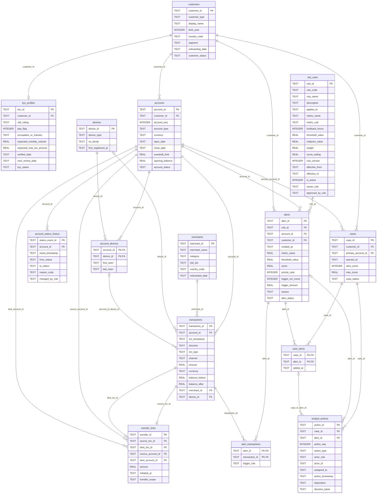

# Entity-relationship diagram

Generated from `generator/schema.sql` by `python -m generator.schema`; do not edit by hand.
Crow's-foot notation: `||` exactly one, `|o` / `o|` zero or one, `o{` zero or many.
A `|o` on the parent side marks an optional (nullable) foreign key.

